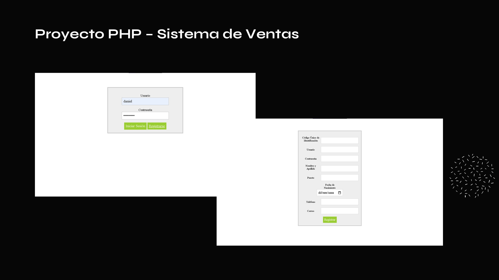
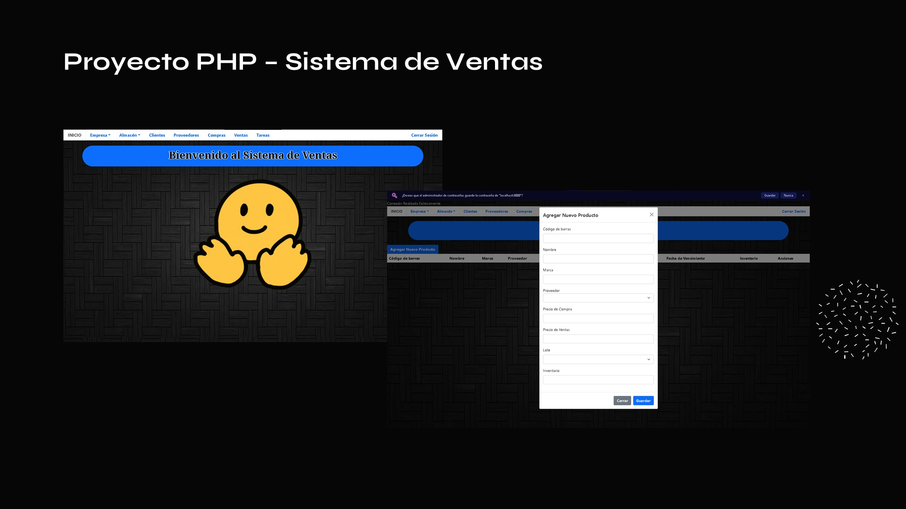
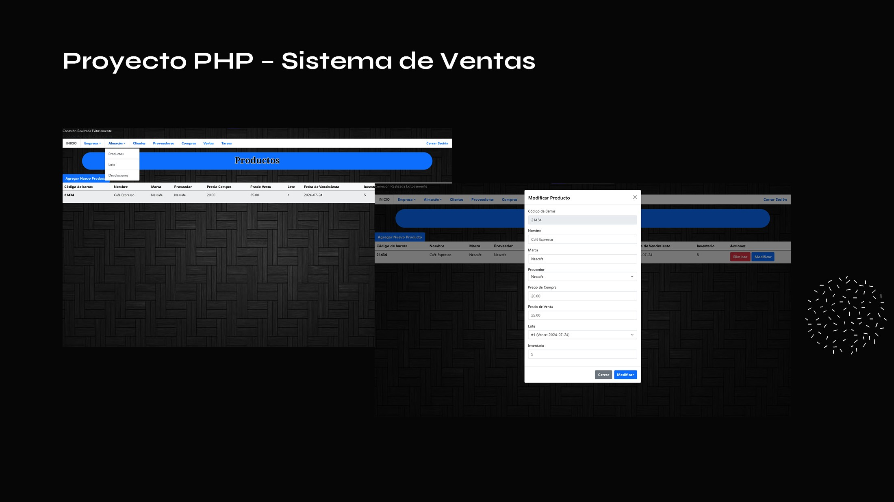

# Sistema de Ventas — PHP

Aplicación web de gestión comercial y administrativa desarrollada con **PHP** (PDO) y **Bootstrap 5**, orientada al control de inventario, compras, ventas, clientes, proveedores y personal.

## Vista previa

| Inicio de sesión y registro | Panel principal y alta de producto | Listado y edición de productos |
| :---: | :---: | :---: |
|  |  |  |

## Características principales

- **Autenticación y acceso:** Inicio de sesión, registro de colaboradores y cierre de sesión.
- **Gestión empresarial:** Módulos CRUD para sucursales, departamentos, puestos, colaboradores y asignación de tareas.
- **Almacén e inventario:** Administración de productos (código de barras, precios, lote e inventario), lotes y devoluciones.
- **Operaciones comerciales:** Registro y mantenimiento de clientes, proveedores, compras y ventas.

## Tecnologías utilizadas

- **PHP** (PDO para consultas preparadas SQL)
- **HTML5** y **CSS3**
- **Bootstrap 5.0.2** y **Google Fonts** (vía CDN)

## Contexto y estado del proyecto

- **Contexto:** Proyecto académico de desarrollo web backend/frontend en PHP.
- **Estado:** Finalizado (archivado para portafolio; el archivo local de conexión `conexion.php` no se incluye en el repositorio por configuración de `.gitignore`).

## Autor

**Daniel Alejandro Arita Leiva**
